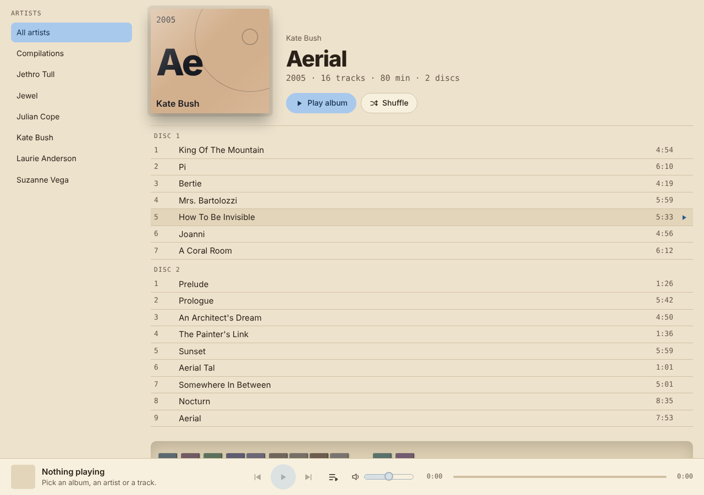
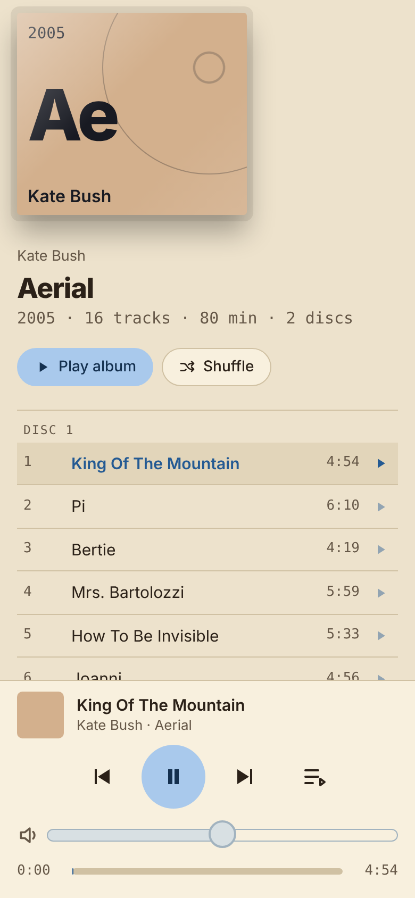

# CD Library

A web app for a Raspberry Pi that turns a collection of ripped CDs into a shelf you can browse and play.

Your albums appear as CD spines standing on wooden shelves, coloured by artist. Click a spine and the case lifts out above the shelf with its track list. Press play and the music comes out of the Pi (and whatever DAC or speakers are attached to it), controlled from any browser on your network, including your phone.



## What it does

- **A shelf of CDs.** One spine per album, filed by artist then year. Each artist has one colour, and each of their albums is a lighter or darker shade of it, so albums by the same artist read as a family.
- **Open a case.** The case lifts out above the shelf with the cover, details and track list. It stays open until you pick another album.
- **Play anything.** Play an album, shuffle an album, play a single track, or play the lot.
- **Lucky buttons.** *Lucky album* picks a random CD, plays it in order, then carries on with other random albums. *Lucky track* plays a random track, then the whole library shuffled.
- **Player bar.** Previous, play/pause, next, a queue, a progress bar you can seek with, and a volume slider.
- **Search** across artists, albums and tracks.
- **Settings (the gear).** Change the music folder and rebuild the catalogue with one button after ripping more CDs.
- **Works on a phone.** On narrow screens the shelf becomes a plain list of albums (the spines are too thin to tap) and the player controls get large touch targets.



## How it works

```
Browser (phone, laptop, the Pi's own screen)
   |  loads the page, and calls the helper's /api/ endpoints
   v
server.py  (port 8080)  --- reads tags with ffprobe --->  music folder (Artist/Album/tracks)
   |
Browser also talks directly to:
   v
Mopidy  (port 6680, WebSocket JSON-RPC)  --->  the Pi's audio output
```

There are only two moving parts, and neither needs a build step or any packages beyond the Python standard library.

1. **`server.py`** is a small helper. It serves the page, remembers the music folder, and scans the folder (using `ffprobe`) to build the catalogue (`library.json`). It fills the catalogue into the page each time the page is loaded.
2. **`template.html`** is the whole front end: one self-contained HTML file with its CSS and JavaScript inline. It contains a `__LIB__` placeholder where the catalogue goes, so **it cannot be opened directly in a browser**. It has to be served by `server.py`.

Playback is done by [Mopidy](https://mopidy.com), which the page controls over its WebSocket API (`core.tracklist.add`, `core.playback.play`, and so on). When Mopidy isn't reachable the page falls back to a pretend timer so you can still try the interface.

## Requirements

- A Raspberry Pi (developed on a Pi 4) running Raspberry Pi OS, with a DAC or other audio output.
- **Mopidy** with the `file` backend enabled and its HTTP server reachable on the network.
- **ffmpeg** (for `ffprobe`): `sudo apt install ffmpeg`
- Python 3 (already on Raspberry Pi OS).
- Music organised as `Artist/Album/track files` (the layout the macOS Music app creates). Tracks need title, track number and date tags for the best result. Apple Lossless (`.m4a`), MP3, FLAC, Ogg and WAV are scanned.

## Set up

### 1. Put the files on the Pi

```
ssh pi@raspberrypi.local "mkdir -p ~/cdlibrary"
scp server.py template.html pi@raspberrypi.local:~/cdlibrary/
```

(Use your own user name and host name.)

### 2. Let Mopidy play your music folder

Mopidy only plays files inside the folders listed under `[file] media_dirs`. If it runs as a service it has its own configuration. Check what it really uses with:

```
sudo mopidyctl config | grep -A5 -E '^\[(file|http)\]'
```

Edit `/etc/mopidy/mopidy.conf` so that it contains your music folder, and allows the page to talk to Mopidy. The page is served on port 8080, so that origin has to be allowed:

```ini
[file]
enabled = true
media_dirs =
    /home/pi/Music

[http]
enabled = true
hostname = 0.0.0.0
port = 6680
allowed_origins =
    raspberrypi.local:8080
```

Then restart it: `sudo systemctl restart mopidy`. If you also open the page by IP address, add that origin too (for example `192.168.1.50:8080`).

The Mopidy service runs as its own user, so it must be able to read the music folder. Linux file names are case-sensitive: `Music` and `music` are different folders.

### 3. Run the helper

```
cd ~/cdlibrary
python3 server.py
```

It listens on port 8080 (set `CDLIB_PORT` to change that) and starts a scan straight away if there is no catalogue yet. Open `http://raspberrypi.local:8080`.

If the shelf is empty, click the **gear**, check the **music folder**, and click **Rebuild catalogue**.

### 4. Start it at boot

Create `/etc/systemd/system/cdlibrary.service` (change the user and paths to suit):

```ini
[Unit]
Description=CD Library
After=network-online.target

[Service]
User=pi
WorkingDirectory=/home/pi/cdlibrary
ExecStart=/usr/bin/python3 server.py
Restart=always

[Install]
WantedBy=multi-user.target
```

```
sudo systemctl enable --now cdlibrary
```

## Day-to-day use

- **Added more CDs?** Open the gear and click **Rebuild catalogue**. The page reloads when the scan finishes.
- **Moved the music?** Change the folder in the gear and click **Save**, then **Rebuild catalogue**. Remember that Mopidy's `media_dirs` has to include the new location too.
- **Updated the page?** Copy the new `template.html` across with `scp` and reload the browser. The helper reads it on every load, so there's nothing to restart.

## The helper's API

| Endpoint | What it does |
|---|---|
| `GET /` | The page, with the catalogue filled in |
| `GET /api/settings` | The current settings (`music_dir`) |
| `POST /api/settings` | Save a new music folder (must exist) |
| `GET /api/rescan` | Scan progress: `running`, `done`, `total`, `finished`, `error` |
| `POST /api/rescan` | Start a scan |

Files written next to `server.py`: `config.json` (settings) and `library.json` (the catalogue). Both are ignored by git.

## Troubleshooting

- **"Scan failed: No such file or directory".** The music folder in settings doesn't exist. Check the capitalisation.
- **Banner says Mopidy isn't answering.** Is Mopidy running (`systemctl status mopidy`)? Is its HTTP server listening on `0.0.0.0`? Is the page's origin in `allowed_origins`?
- **Play does nothing, or "Mopidy could not find those files".** The music folder isn't inside Mopidy's `media_dirs`, or the Mopidy user can't read it.
- **Volume slider is greyed out.** Mopidy has no mixer for your audio output. Some DACs have no software volume control.
- **`__LIB__ is not defined` in the browser console.** The template was opened as a file instead of being served by `server.py`.
- **Tracks marked "incomplete file".** They have no readable length, usually because a rip failed. Replace the file and rebuild the catalogue.

## Development notes

- The front end is deliberately one file, with no dependencies and no build step. Fonts come from Google Fonts and fall back to system fonts when offline.
- The page is light-only by design (a warm cream background and pale blue controls).
- The phone layout starts at 640px wide and swaps the shelf for a list. The desktop layout is untouched by it.
- Colours: each artist gets a hue spaced around the colour wheel in order of first appearance, and each album a small lightness step. Adding a new artist can change the hue of artists that sort after it. Remembering each artist's colour is on the to-do list.

## To do

- Album art: show real covers (`cover.jpg` / `folder.jpg` in each album folder) in place of the generated tiles.
- Remember each artist's colour permanently.
- Tag tidy-ups: group compilations under "Various Artists", keep colons in album names, show year ranges for best-ofs.
- Optional physical shuffle button on the Pi.
